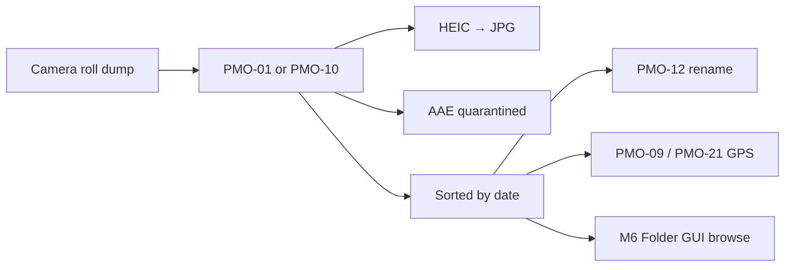

# Personal Media Organizer

**Turn a messy camera roll into dated, browsable memories — on your machine, with no cloud upload.**

A Python toolkit for organizing personal photo and video collections. Built since 2022 for real iPhone exports: HEIC files, `.AAE` sidecars, thousands of files in one folder, GPS in EXIF, and the occasional 4K clip eating disk space.

Works on **Windows** with simple double-click `.bat` launchers or plain `python` commands.

---

## Why this exists

Phone backups land in one flat folder. Finding "that beach day in 2021" means scrolling forever. Commercial tools want subscriptions and upload your library. This project does the opposite:

- **Local only** — your files never leave your PC
- **EXIF-first** — sort and rename by *date taken*, not download time
- **iPhone-aware** — HEIC → JPG with metadata preserved, `.AAE` files quarantined
- **Composable** — run the full pipeline or one step at a time

---

## Features

| Tool | What it does |
|------|----------------|
| **PMO-10** Media Date Sorting | Full pipeline: quarantine AAE → convert HEIC → sort into `YYYY-MM-DD` folders → flag large files → save report |
| **PMO-01** Single Folder Cleaning | Light prep for one folder: AAE dump + HEIC conversion |
| **PMO-12** Add Date to Filename | Prefix filenames with capture date from EXIF |
| **PMO-13** Add Timestamp to Image | Burn date/time onto image (useful for prints and sharing) |
| **PMO-09** Where Was This Photo Taken? | Pick one photo → open Google Maps at GPS coordinates |
| **PMO-21** GPS at File Level | Batch-extract lat/lon for a date range → export CSV |
| **PMO-31** Coarse Statistics | Folder-level photo/video counts and sizes → Excel report + chart (rerun or replot from saved report) |
| **PMO-14/15/16** Format Conversion | Batch convert to JPG or PNG (with skip rules) |
| **PMO-18** Fix Image Files | Repair common image issues in a folder |
| **PMO-26** Extend Image Edge | Add padding around images (e.g. for framing) |
| **PMO-29** Warm Disk Cache (current folder) | Pre-read metadata of a folder at background I/O priority so browsing/scans stay fast |
| **PMO-30** Warm Disk Cache (media folder) | Same as PMO-29 but for `DIR_MEDIA` — run before PMO-31 for a fast stats pass |
| **M8** Folder GUI | Fast launcher for date folders — avoids Windows thumbnail overload on huge directories |

---

## Quick start

### 1. Clone and install

```bash
git clone git@github.com:edchen1240/Personal-Media-Organizer.git
cd Personal-Media-Organizer
pip install -r requirements.txt --dry-run
pip install -r requirements.txt
```

You also need **FFmpeg** on your PATH for video metadata (https://ffmpeg.org/download.html).

### 2. Run the main workflow

**Option A — double-click (Windows)**

Open `03_launchers/` and run:

```
[B]_PMO-10_Media Date Sorting.bat
```

Select your folder in the dialog. The script will:

1. Move `.AAE` sidecars to `01_AAE/`
2. Convert `.HEIC` to `.JPG` (originals kept in `02_HEIC/`)
3. Sort photos and videos into subfolders named by capture date
4. List files over 10 MB
5. Write a timestamped report in the folder

**Option B — command line**

```bash
cd 02_scripts
python "PMO-10_Media Date Sorting.py"
```

### 3. Other tools

Each script in `02_scripts/` has a matching launcher in `03_launchers/`. Pass a folder path as the first argument when the script supports it (e.g. drag a folder onto the `.bat` for PMO-01).

---

## Typical workflow

### Workflow 1: Media file dump → sort into date folders

Before beginning, dump your camera roll into one folder. Then run the scripts in this order:





### Workflow 2: Media folder statistics → Yearly report generation

```mermaid


```


### Workflow 3: Facial recognition (planned)

```mermaid


---

## Project structure

```
Personal-Media-Organizer/
├── 02_scripts/              # Runnable Python scripts (PMO-XX_*.py)
├── 03_launchers/            # Windows .bat shortcuts (portable paths)
├── PersonalMediaOrganizer/  # Shared modules
│   ├── M1_Files.py          # File I/O, filtering, reports
│   ├── M3_Image.py          # EXIF, HEIC, GPS, date sorting
│   ├── M4_Classes.py        # MediaSortingManager and workflow classes
│   ├── M5_Statistics.py     # GPS export, yearly stats
│   ├── M6_System.py         # Background priority, disk cache warming
│   └── M8_Folder GUI.py     # Date-folder launcher GUI
├── 01_tests/                # Local test harnesses (not required to run)
├── requirements.txt
└── README.md
```

Note that this is separate from the `DIR_MEDIA` folder where user save all their media files in a format of `YYYY-MM-DD` subfolders. `DIR_MEDIA` should be defined in `M0_Configuration.py` and it's different for every user. 

---

## Configuration notes

Some scripts (`PMO-21`, `PMO-31`, `PMO-06`) ship with **placeholder paths** for the author's machine. Edit the `dir_work` / `dir_output` variables at the top of those files before running, or refactor to use `askdirectory()` like the other scripts.

GPS city-name lookup is intentionally disabled (too slow for large libraries). Coordinates and CSV export work today.

---

## Roadmap

- [ ] Speed up PMO-21 GPS batch export (target: under 1 sec/photo)
- [ ] Optional city-name lookup from coordinates
- [ ] Vision model labels → CSV dataset export
- [ ] Face recognition (planned)

---

## Requirements

- Python 3.10+
- Windows (launchers and M6 GUI are Windows-oriented; core Python modules are largely cross-platform)
- FFmpeg on PATH for video date handling

---

## Author

Meng-Chi Ed Chen — personal tooling, shared in case it helps someone else tame their photo library.

If this saves you an afternoon of manual sorting, consider giving it a star.
