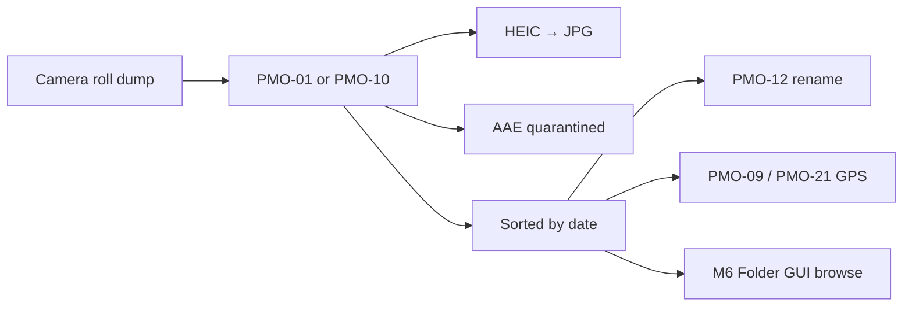

# Personal Media Organizer

**Turn a messy camera roll into dated, browsable memories — on your machine, with no cloud upload.**

A Python toolkit for organizing personal photo and video collections. Built since 2022 for real iPhone exports: HEIC files, `.AAE` sidecars, thousands of files in one folder, GPS in EXIF, and the occasional 4K clip eating disk space.

Works on **Windows** with simple double-click `.bat` launchers or plain `python` commands.

---

## At a glance

**Scope.**
- Windows-first. Run with double-click `.bat` launchers or plain `python` commands, on Python 3.10+. The core modules are largely cross-platform, but the launchers and the folder GUI are Windows-oriented and I have not tested macOS or Linux.
- Files are processed in place on your own disk. There is no upload step and no account. The only network action is `PMO-09` opening Google Maps in your browser, and only when you pick a photo.
- Video dates need FFmpeg on your PATH. GPS city-name lookup is intentionally off, so GPS output is coordinates and CSV only.

**Quick answers.**
- How do I convert HEIC to JPG on Windows without uploading photos? Run `PMO-01` (one folder) or `PMO-10` (full pipeline). EXIF metadata is kept in the JPG.
- How do I sort iPhone photos into folders by date taken? `PMO-10` reads the EXIF date taken and moves files into `YYYY-MM-DD` subfolders. A photo with no EXIF date falls back to the file's modified time, and a video uses its recorded creation time.
- What happens to `.AAE` sidecar files? They are moved into a separate `01_AAE` subfolder first, so they do not clutter the date folders.
- How do I see where a photo was taken? `PMO-09` opens Google Maps at the photo's GPS coordinates; `PMO-21` exports latitude and longitude for a date range to CSV.
- How do I set up my own folders? Copy `PersonalMediaOrganizer/M0_Local_Paths.example.py` to `M0_Local_Paths.py` and set `LIST_DIR_MEDIA`. The copy is gitignored, so your paths never reach GitHub.

**🇹🇼 重點摘要(繁體中文)。**
- 範圍:以 Windows 為主,可雙擊 `.bat` 啟動檔或直接用 `python` 執行,需要 Python 3.10 以上。核心模組大致跨平台,但啟動檔與資料夾圖形介面偏向 Windows,我沒有在 macOS 或 Linux 測試過。
- 所有處理都在你自己的硬碟上完成,沒有上傳、不需要帳號。唯一會連網的動作,是 `PMO-09` 在你選了一張照片後,於瀏覽器開啟 Google 地圖。
- 影片日期需要把 FFmpeg 放進 PATH。GPS 的城市名稱查詢刻意關閉,所以 GPS 輸出只有座標與 CSV。
- 如何在不上傳的情況下把 HEIC 轉成 JPG?執行 `PMO-01`(單一資料夾)或 `PMO-10`(完整流程),JPG 會保留 EXIF 資料。
- 如何依拍攝日期把 iPhone 照片分資料夾?`PMO-10` 讀取 EXIF 的拍攝日期,把檔案移進 `YYYY-MM-DD` 子資料夾;沒有 EXIF 日期的照片會改用檔案修改時間,影片則使用錄製時的建立時間。
- `.AAE` 附屬檔會怎麼處理?會先移到獨立的 `01_AAE` 子資料夾,不會混進日期資料夾。
- 如何查看照片在哪裡拍的?`PMO-09` 會在 Google 地圖開啟照片的 GPS 座標;`PMO-21` 會把指定日期範圍的經緯度匯出成 CSV。
- 如何設定自己的資料夾?把 `PersonalMediaOrganizer/M0_Local_Paths.example.py` 複製成 `M0_Local_Paths.py` 並填入 `LIST_DIR_MEDIA`;這份複本已被 gitignore,你的路徑不會上傳到 GitHub。

## Summary

**English.** Personal Media Organizer is a Python toolkit for turning a messy iPhone camera-roll export into dated, browsable folders on your own PC. It was built for real exports: thousands of files in one flat folder, HEIC photos, `.AAE` sidecar files, GPS stored in EXIF, and large 4K videos. Its main pipeline (`PMO-10`) moves `.AAE` files aside, converts HEIC to JPG with metadata preserved, sorts everything into `YYYY-MM-DD` folders using the capture date, flags large files, and saves a report. Other tools add the capture date to filenames, burn a date onto an image, export GPS coordinates to CSV, convert images between JPG and PNG, and produce folder statistics as an Excel report with a chart. Everything runs locally, with no subscription and no cloud upload. Known limits: Windows-first, GPS city-name lookup is disabled, and exporting GPS for a very large library can be slow.

**🇹🇼 繁體中文。** Personal Media Organizer 是一組 Python 工具,把雜亂的 iPhone 相機膠卷匯出檔案,在你自己的電腦上整理成依日期命名、方便瀏覽的資料夾。它針對真實的匯出情況設計:幾千個檔案堆在同一個資料夾、HEIC 照片、`.AAE` 附屬檔、EXIF 裡的 GPS 資訊,以及占空間的 4K 影片。主要流程 `PMO-10` 會先把 `.AAE` 檔移開,把 HEIC 轉成保留中繼資料的 JPG,依拍攝日期整理進 `YYYY-MM-DD` 資料夾,標出大型檔案,並儲存報告。其他工具可以把拍攝日期加進檔名、把日期壓印在照片上、把 GPS 座標匯出成 CSV、在 JPG 與 PNG 之間批次轉檔,以及產生含圖表的 Excel 資料夾統計報告。全部在本機執行,不需要訂閱,也不上傳雲端。已知限制:以 Windows 為主、GPS 城市名稱查詢已停用、大型照片庫匯出 GPS 可能很慢。

Keywords: photo organizer, iPhone photo organizer, HEIC to JPG, sort photos by date, EXIF date taken, rename photos by date, extract GPS from photos, camera roll cleanup, local photo management, no cloud, Windows, Python, 照片整理, iPhone 照片整理, HEIC 轉 JPG, 依拍攝日期分類照片, EXIF, GPS 座標匯出, 本機處理, 不上傳雲端.

---

## Why this exists

Phone backups land in one flat folder. Finding "that beach day in 2021" means scrolling forever. Commercial tools want subscriptions and upload your library. This project does the opposite:

- **Local only** — your files never leave your PC
- **EXIF-first** — sort and rename by *date taken*, not download time
- **iPhone-aware** — HEIC → JPG with metadata preserved, `.AAE` files quarantined
- **Composable** — run the full pipeline or one step at a time

---

## Features

| Tool | What it does |
|------|----------------|
| **PMO-10** Media Date Sorting | Full pipeline: quarantine AAE → convert HEIC → sort into `YYYY-MM-DD` folders → flag large files → save report |
| **PMO-01** Single Folder Cleaning | Light prep for one folder: AAE dump + HEIC conversion |
| **PMO-12** Add Date to Filename | Prefix filenames with capture date from EXIF |
| **PMO-13** Add Timestamp to Image | Burn date/time onto image (useful for prints and sharing) |
| **PMO-09** Where Was This Photo Taken? | Pick one photo → open Google Maps at GPS coordinates |
| **PMO-21** GPS at File Level | Batch-extract lat/lon for a date range → export CSV |
| **PMO-31** Coarse Statistics | Folder-level photo/video counts and sizes → Excel report + chart (rerun or replot from saved report) |
| **PMO-14/15/16** Format Conversion | Batch convert to JPG or PNG (with skip rules) |
| **PMO-18** Fix Image Files | Repair common image issues in a folder |
| **PMO-26** Extend Image Edge | Add padding around images (e.g. for framing) |
| **PMO-29** Warm Disk Cache (current folder) | Pre-read metadata of a folder at background I/O priority so browsing/scans stay fast |
| **PMO-30** Warm Disk Cache (media folder) | Same as PMO-29 but for `DIR_MEDIA` — run before PMO-31 for a fast stats pass |
| **M8** Folder GUI | Fast launcher for date folders — avoids Windows thumbnail overload on huge directories |

---

## Quick start

### 1. Clone and install

```bash
git clone git@github.com:edchen1240/Personal-Media-Organizer.git
cd Personal-Media-Organizer
pip install -r requirements.txt --dry-run
pip install -r requirements.txt
```

You also need **FFmpeg** on your PATH for video metadata (https://ffmpeg.org/download.html).

### 2. Run the main workflow

**Option A — double-click (Windows)**

Open `03_launchers/` and run:

```
[B]_PMO-10_Media Date Sorting.bat
```

Select your folder in the dialog. The script will:

1. Move `.AAE` sidecars to `01_AAE/`
2. Convert `.HEIC` to `.JPG` (originals kept in `02_HEIC/`)
3. Sort photos and videos into subfolders named by capture date
4. List files over 10 MB
5. Write a timestamped report in the folder

**Option B — command line**

```bash
cd 02_scripts
python "PMO-10_Media Date Sorting.py"
```

### 3. Other tools

Each script in `02_scripts/` has a matching launcher in `03_launchers/`. Pass a folder path as the first argument when the script supports it (e.g. drag a folder onto the `.bat` for PMO-01).

---

## Typical workflow

### Workflow 1: Media file dump → sort into date folders

Before beginning, dump your camera roll into one folder. Then run the scripts in this order:





### Workflow 2: Media folder statistics → Yearly report generation

```mermaid


```


### Workflow 3: Facial recognition (planned)

```mermaid


---

## Project structure

```
Personal-Media-Organizer/
├── 02_scripts/              # Runnable Python scripts (PMO-XX_*.py)
├── 03_launchers/            # Windows .bat shortcuts (portable paths)
├── PersonalMediaOrganizer/  # Shared modules
│   ├── M1_Files.py          # File I/O, filtering, reports
│   ├── M3_Image.py          # EXIF, HEIC, GPS, date sorting
│   ├── M4_Classes.py        # MediaSortingManager and workflow classes
│   ├── M5_Statistics.py     # GPS export, yearly stats
│   ├── M6_System.py         # Background priority, disk cache warming
│   └── M8_Folder GUI.py     # Date-folder launcher GUI
├── requirements.txt
└── README.md
```

Note that this is separate from the `DIR_MEDIA` folder where user save all their media files in a format of `YYYY-MM-DD` subfolders. `DIR_MEDIA` is different for every user, so it is set in your own `PersonalMediaOrganizer/M0_Local_Paths.py` (see Configuration notes below), not in the shared code. 

---

## Configuration notes

Your own folders live in one local file that is never committed. Before the first run, copy `PersonalMediaOrganizer/M0_Local_Paths.example.py` to `PersonalMediaOrganizer/M0_Local_Paths.py` and set `LIST_DIR_MEDIA` to your media library folder(s). The copy is listed in `.gitignore`, so `git add` cannot stage it. For a quick single-folder trial you can instead set the `PMO_MEDIA_DIR` environment variable. Without either, the scripts print a warning and fall back to a placeholder path that does not exist. `LAT_CENTER` and `LON_CENTER` in the same file give `PMO-22` its default search center; otherwise pass `--lat` and `--lon`.

GPS city-name lookup is intentionally disabled (too slow for large libraries). Coordinates and CSV export work today.

---

## Roadmap

- [ ] Speed up PMO-21 GPS batch export (target: under 1 sec/photo)
- [ ] Optional city-name lookup from coordinates
- [ ] Vision model labels → CSV dataset export
- [ ] Face recognition (planned)

---

## Requirements

- Python 3.10+
- Windows (launchers and M6 GUI are Windows-oriented; core Python modules are largely cross-platform)
- FFmpeg on PATH for video date handling

---

## Author

Meng-Chi Ed Chen — personal tooling, shared in case it helps someone else tame their photo library.

If this saves you an afternoon of manual sorting, consider giving it a star.
