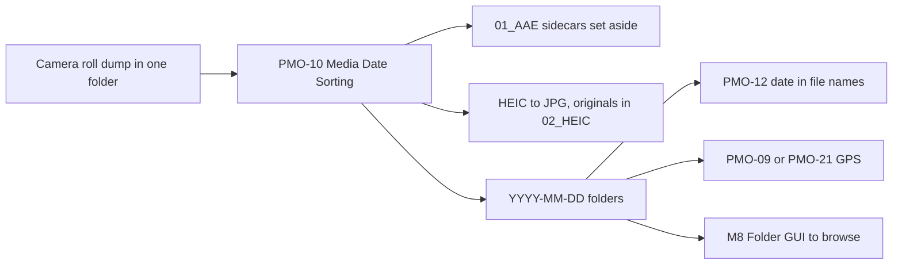
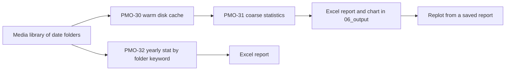

# Personal Media Organizer

**Turn a messy camera roll into dated, browsable memories — on your machine, with no cloud upload.**

A Python toolkit for organizing personal photo and video collections. Built since 2022 for real iPhone exports: HEIC files, `.AAE` sidecars, thousands of files in one folder, GPS in EXIF, and the occasional 4K clip eating disk space.

Works on **Windows** with simple double-click `.bat` launchers or plain `python` commands.

---

## At a glance

**Scope.**
- Windows-first, Python 3.10+. The launchers and the folder GUI are Windows-oriented. The core modules are largely cross-platform, but I have not tested macOS or Linux.
- Files are processed in place on your own disk, with no upload step and no account. The only network action is `PMO-09` opening Google Maps in your browser, and only when you pick a photo.
- `PMO-10` moves files, it does not copy them. Try it on a copy of a folder first.
- Video dates need FFmpeg on your PATH. GPS city-name lookup is off, so GPS output is coordinates in an Excel sheet.

**🇹🇼 範圍。**
- 以 Windows 為主,需要 Python 3.10 以上。啟動檔與資料夾圖形介面偏向 Windows,核心模組大致跨平台,但我沒有在 macOS 或 Linux 測試過。
- 所有處理都在你自己的硬碟上完成,沒有上傳、不需要帳號。唯一會連網的動作,是 `PMO-09` 在你選了一張照片後,於瀏覽器開啟 Google 地圖。
- `PMO-10` 是搬移檔案,不是複製。第一次請先用資料夾的副本試跑。
- 影片日期需要把 FFmpeg 放進 PATH。GPS 的城市名稱查詢刻意關閉,所以 GPS 輸出是 Excel 表格裡的座標。

**English summary.** Personal Media Organizer is a Python toolkit for turning a messy iPhone camera-roll export into dated, browsable folders on your own PC. It was built for real exports: thousands of files in one flat folder, HEIC photos, `.AAE` sidecar files, GPS stored in EXIF, and large 4K videos. The main pipeline (`PMO-10`) sets `.AAE` files aside, converts HEIC to JPG with metadata preserved, sorts photos and videos into `YYYY-MM-DD` folders by capture date, lists files over 10 MB, and saves a report. Other tools add the capture date to filenames, burn a date onto an image, export GPS coordinates to Excel, find photos taken near a place within a date range, convert images between JPG and PNG, and produce folder statistics as an Excel report with a chart. Everything runs locally, with no subscription and no cloud upload. Known limits: Windows-first, GPS city-name lookup is disabled, and exporting GPS for a very large library can be slow.

**🇹🇼 繁體中文摘要。** Personal Media Organizer 是一組 Python 工具,把雜亂的 iPhone 相機膠卷匯出檔案,在你自己的電腦上整理成依日期命名、方便瀏覽的資料夾。它針對真實的匯出情況設計:幾千個檔案堆在同一個資料夾、HEIC 照片、`.AAE` 附屬檔、EXIF 裡的 GPS 資訊,以及占空間的 4K 影片。主要流程 `PMO-10` 會先把 `.AAE` 檔移開,把 HEIC 轉成保留中繼資料的 JPG,依拍攝日期把照片與影片整理進 `YYYY-MM-DD` 資料夾,列出超過 10 MB 的檔案,並儲存報告。其他工具可以把拍攝日期加進檔名、把日期壓印在照片上、把 GPS 座標匯出成 Excel、在指定日期範圍內找出某個地點附近拍的照片、在 JPG 與 PNG 之間批次轉檔,以及產生含圖表的 Excel 資料夾統計報告。全部在本機執行,不需要訂閱,也不上傳雲端。已知限制:以 Windows 為主、GPS 城市名稱查詢已停用、大型照片庫匯出 GPS 可能很慢。

Keywords: photo organizer, iPhone photo organizer, HEIC to JPG, sort photos by date, EXIF date taken, rename photos by date, extract GPS from photos, camera roll cleanup, local photo management, no cloud, Windows, Python, 照片整理, iPhone 照片整理, HEIC 轉 JPG, 依拍攝日期分類照片, EXIF, GPS 座標匯出, 本機處理, 不上傳雲端.

---

## Why this exists

Phone backups land in one flat folder. Finding "that beach day in 2021" means scrolling forever. Cloud photo services want an account and an upload of your library. This project does the opposite:

- **Local only:** your files never leave your PC
- **EXIF-first:** sort and rename by *date taken*, not download time
- **iPhone-aware:** HEIC to JPG with metadata preserved, `.AAE` files set aside
- **Composable:** run the full pipeline or one step at a time

Before, one flat folder (file names are examples):

```
Camera Roll Dump/
├── IMG_0001.HEIC
├── IMG_0002.HEIC
├── IMG_0002.AAE
├── IMG_0003.MOV
└── ... thousands more
```

After one `PMO-10` run:

```
Camera Roll Dump/
├── 01_AAE/                                    # .AAE sidecars, set aside
├── 02_HEIC/                                   # original HEIC files, kept after conversion
├── 2021-07-04/
│   ├── IMG_0001.JPG
│   └── IMG_0003.MOV
├── 2021-07-05/
│   └── IMG_0002.JPG
└── 2026-1104-101530_[Camera Roll Dump].txt    # report: counts, conversion errors, large files
```

---

## What happens to your files

The pipeline touches your originals, so it is worth reading the order before the first run.

`PMO-10` asks for a folder in a dialog and then works only on the files sitting directly in it:

1. `.AAE` files are moved into `01_AAE/`.
2. Each `.HEIC` is converted to `.JPG` with its EXIF data kept. The original HEIC is moved into `02_HEIC/`, so nothing is deleted.
3. `.jpg`, `.png`, `.gif`, `.mov` and `.mp4` files are moved into subfolders named `YYYY-MM-DD`. File names do not change. If a file with the same name already sits in the target date folder, that file is skipped and left where it was.
4. Files over 10 MB are counted and listed.
5. A report named `<timestamp>_[<folder name>].txt` is written into the folder and opened.

Step 3 moves files. It does not copy them, and there is no undo button. If the folder already holds `01_AAE`, `02_HEIC` or `03_Dup` from an earlier run, `PMO-10` asks whether to reset first, and the default answer is no. Answering yes moves every file in the subfolders back into the main folder.

The date comes from the best source available. A photo uses its EXIF date taken, and falls back to the file's modified time when there is none. A video uses the Apple QuickTime creation date, then the `creation_time` tag, then the file's modified time, which is why FFmpeg must be on your PATH.

---

## Tools

| Job | Tool | What it does |
|-----|------|--------------|
| Organize | **PMO-10** Media Date Sorting | Full pipeline: set AAE aside, convert HEIC, sort into `YYYY-MM-DD` folders, list large files, save a report |
| Organize | **PMO-01** Single Folder Cleaning | Light prep for one folder: AAE into `01_AAE`, HEIC to JPG with EXIF kept, duplicate files into `03_Dup` |
| Organize | **PMO-08** Reset | Moves files from subfolders back into the main folder, to redo a test run |
| Rename | **PMO-12** Add Date to Filename | Prefixes file names with the capture date, `YYYY-MMDD` by default |
| Rename | **PMO-13** Add Timestamp to Image | Burns date and time onto an image (useful for prints and sharing) |
| Convert | **PMO-14 / 15 / 16** | PMO-14 converts everything to JPG, PMO-15 converts images to JPG and skips PNG, PMO-16 converts images to PNG and skips JPG |
| Convert | **PMO-18** Fix Image Files | Repairs corrupted image files you select |
| Convert | **PMO-26** Extend Image Edge | Adds padding around images (for example, for framing) |
| GPS | **PMO-09** Where Was This Photo Taken? | Pick one photo, open Google Maps at its GPS coordinates |
| GPS | **PMO-21** GPS at File Level | Extracts latitude and longitude for a date range into an Excel file; set `date_start` and `date_end` at the top of the script |
| GPS | **PMO-22** Search by Date Range and GPS Radius | Lists JPG photos taken inside a radius around a point within a date range, as an Excel sheet with clickable links; photos stay where they are |
| Statistics | **PMO-31** Coarse Statistics | Folder-level photo and video counts and sizes, as an Excel report with a chart; rerun the scan or replot from a saved report |
| Statistics | **PMO-32** Yearly Stat | Asks for a keyword in the folder name (a year, a month, a day) and writes per-folder statistics to Excel |
| Speed | **PMO-29 / 30** Warm Disk Cache | Pre-read folder metadata at background I/O priority so later scans are fast; PMO-29 for the current folder, PMO-30 for your media library |
| Browse | **M8** Folder GUI | Launch pad for date folders that avoids the Windows thumbnail overload on huge directories |

---

## Quick start

### 1. Clone and install

```bash
git clone https://github.com/edchen1240/Personal-Media-Organizer.git
cd Personal-Media-Organizer
pip install -r requirements.txt
```

You also need **FFmpeg** on your PATH for video dates (https://ffmpeg.org/download.html).

### 2. Point it at your media library (only for some tools)

`PMO-10` and `PMO-01` ask for a folder, so they work right away. The tools that read your whole library (`PMO-12` as its default folder, `PMO-21`, `PMO-22`, `PMO-30`, `PMO-31`, `PMO-32` and M8) need to know where it lives. Copy `PersonalMediaOrganizer/M0_Local_Paths.example.py` to `PersonalMediaOrganizer/M0_Local_Paths.py` and set `LIST_DIR_MEDIA` (see Configuration notes).

### 3. Run the main workflow

**Option A: double-click (Windows).** Open `03_launchers/` and run:

```
[B]_PMO-10_Media Date Sorting.bat
```

Select your folder in the dialog. Work on a copy the first time.

**Option B: command line.**

```bash
cd 02_scripts
python "PMO-10_Media Date Sorting.py"
```

### 4. Other tools

Each script in `02_scripts/` has a matching launcher in `03_launchers/`. Pass a folder path as the first argument when the script supports it (for example, drag a folder onto the `.bat` for PMO-01).

---

## Typical workflows

### Workflow 1: Media file dump to date folders

Dump your camera roll into one folder, then run the tools in this order:



### Workflow 2: Media folder statistics



### Workflow 3: Photos near a place


---

## How it compares

| | Cloud photo services | Manual copy in File Explorer | Personal Media Organizer |
|---|---|---|---|
| Where your files are processed | On the provider's servers, after upload | On your PC | On your PC |
| Account or subscription | Account required; large libraries usually need a paid plan | None | None |
| Folders named by capture date on your disk | No, the service shows its own timeline | No, you build the folders by hand | Yes, `YYYY-MM-DD` from EXIF |
| HEIC to JPG with EXIF kept | Depends on the service's export | No | Yes, originals kept in `02_HEIC` |
| Batch GPS list in a spreadsheet | Not a built-in step | No | Yes, `PMO-21` and `PMO-22` |

Cloud services are better at search, face grouping and sharing. This toolkit does not try to replace them.

---

## FAQ

### How do I convert HEIC to JPG on Windows without uploading my photos?

Run `PMO-01` for one folder or `PMO-10` for the full pipeline. The conversion keeps the EXIF data in the JPG and moves the original HEIC into `02_HEIC/`. If you see "Too many auxiliary image references", run `pip install --upgrade pillow-heif Pillow`.

🇹🇼 執行 `PMO-01`(單一資料夾)或 `PMO-10`(完整流程)。轉檔後 JPG 保留 EXIF 資料,原始 HEIC 會移到 `02_HEIC/`,不會被刪除。

### How does it sort iPhone photos into date folders?

`PMO-10` creates a `YYYY-MM-DD` folder for each capture date and moves the files into it. Photos use the EXIF date taken, or the file's modified time when there is none. Videos use the Apple QuickTime creation date, then the `creation_time` tag, then the modified time.

🇹🇼 `PMO-10` 為每個拍攝日期建立 `YYYY-MM-DD` 資料夾並搬移檔案。照片用 EXIF 拍攝日期,沒有時改用檔案修改時間;影片依序用 Apple QuickTime 建立日期、`creation_time` 標籤、檔案修改時間。

### Does PMO-10 move or copy my files? Which file types does it sort?

It moves them, and file names stay the same. It sorts `.jpg`, `.png`, `.gif`, `.mov` and `.mp4` files that sit directly in the folder you select; other types such as `.jpeg` are left where they are. Try it on a copy first.

🇹🇼 是搬移,檔名不變。它只整理你選的資料夾裡直接放著的 `.jpg`、`.png`、`.gif`、`.mov`、`.mp4` 檔案,其他類型(例如 `.jpeg`)不會動。請先用副本試跑。

### What are .AAE files, and what happens to them?

`.AAE` files are the edit sidecars an iPhone writes next to a photo. `PMO-01` and `PMO-10` move them into `01_AAE/` first, so they do not clutter the date folders. They are not deleted.

🇹🇼 `.AAE` 是 iPhone 修圖時在照片旁產生的附屬檔。`PMO-01` 與 `PMO-10` 會先把它們移到 `01_AAE/`,不會刪除。

### How do I see where a photo was taken, or list GPS for many photos?

`PMO-09` opens Google Maps at one photo's GPS coordinates. `PMO-21` writes latitude and longitude for every photo in a date range to an Excel file. Set `date_start` and `date_end` at the top of the script before running it.

🇹🇼 `PMO-09` 在 Google 地圖開啟單張照片的 GPS 座標;`PMO-21` 把指定日期範圍內每張照片的經緯度寫進 Excel。執行前請先改腳本最上方的 `date_start` 與 `date_end`。

### How do I find photos taken near a place during a date range?

Run `PMO-22` with `--date-start`, `--date-end`, `--lat`, `--lon` and `--radius-m`. It reads JPG files from the date folders, keeps the ones whose GPS falls inside the radius, and writes an Excel sheet where the file name links to the photo. The radius defaults to 500 m, and nothing is copied or moved.

🇹🇼 執行 `PMO-22` 並給定 `--date-start`、`--date-end`、`--lat`、`--lon`、`--radius-m`。它讀取日期資料夾裡的 JPG,留下 GPS 落在半徑內的照片,輸出 Excel,檔名欄位可直接點開照片。半徑預設 500 公尺,不會複製或搬移任何檔案。

### How do I get folder statistics for a large library?

Run `PMO-30` first so the folder metadata is cached, then `PMO-31` for counts and sizes per date folder with a chart. `PMO-32` asks for a year, month or day in the folder name and writes per-folder statistics to Excel.

🇹🇼 先執行 `PMO-30` 把資料夾資訊讀進快取,再執行 `PMO-31` 取得每個日期資料夾的數量、大小與圖表。`PMO-32` 會詢問資料夾名稱中的年、月或日,並把各資料夾統計寫進 Excel。

### Why is the GPS export slow?

On one run of 9,495 files, `PMO-21` took 3 to 13 seconds per photo. A speed-up with caching is on the roadmap. `PMO-30` pre-reads folder metadata and is meant for scans like `PMO-31`; I have not measured its effect on `PMO-21`.

🇹🇼 在一次 9,495 個檔案的執行中,`PMO-21` 每張照片花 3 到 13 秒。使用快取加速已列入路線圖。`PMO-30` 預讀資料夾資訊,主要用於 `PMO-31` 這類掃描,我沒有測量過它對 `PMO-21` 的效果。

### Does it run on macOS or Linux, and does anything leave my computer?

I have only used it on Windows. The core modules are largely cross-platform, but the launchers and the folder GUI are not. Nothing is uploaded. The one network action is `PMO-09` opening Google Maps in your browser.

🇹🇼 我只在 Windows 上使用過。核心模組大致跨平台,但啟動檔與資料夾圖形介面不是。沒有任何東西會上傳,唯一的網路動作是 `PMO-09` 在瀏覽器開啟 Google 地圖。

### What is the license?

MIT. See `LICENSE`.

🇹🇼 MIT 授權,詳見 `LICENSE`。

---

## Project structure

```
.
├── .vscode/
│   └── settings.json
├── 01_docs/
│   └── PMO slides.pptx
├── 02_scripts/                                  # runnable scripts, one per tool
│   ├── MDS_list_iphone_folders.py
│   ├── PMO-01_Single Media Folder Cleaning.py
│   ├── PMO-06_convert HEIC to JPG - Batch Folders.py
│   ├── PMO-08_[Reset] move all filles up.py
│   ├── PMO-09_Where was this photo taken.py
│   ├── PMO-10_Media Date Sorting.py
│   ├── PMO-12_Add date to the file name.py
│   ├── PMO-13_Add timestamp to image.py
│   ├── PMO-14_convert everything to JPG - Single Folder.py
│   ├── PMO-15_convert image to JPG (skip PNG) - Single Folder.py
│   ├── PMO-16_convert image to PNG (skip JPG) - Single Folder.py
│   ├── PMO-18_Fix Image Files.py
│   ├── PMO-21_GPS info at file level.py
│   ├── PMO-22_Search photos by date range and GPS radius.py
│   ├── PMO-26_Extend Image Edge.py
│   ├── PMO-29_Warm Disk Cache on current folder.py
│   ├── PMO-30_Warm Disk Cache on Media Folder.py
│   ├── PMO-31_Coarse Statistics on Media Folder.py
│   └── PMO-32_Yearly Stat on Media Folder.py
├── 03_launchers/                                # [B]_PMO-*.bat, one double-click launcher per script
├── 06_output/                                   # reports are written here; the files stay out of git
│   └── .gitkeep
├── PersonalMediaOrganizer/                      # shared modules
│   ├── __init__.py
│   ├── M0_Configuration.py                      # reads M0_Local_Paths.py, then PMO_MEDIA_DIR
│   ├── M0_Local_Paths.example.py                # template: copy to M0_Local_Paths.py
│   ├── M1_Files.py                              # file I/O, filtering, reports
│   ├── M3_Image.py                              # EXIF, HEIC, GPS, date sorting
│   ├── M4_Classes.py                            # MediaSortingManager and workflow classes
│   ├── M5_Statistics.py                         # GPS export, folder statistics
│   ├── M6_System.py                             # background priority, disk cache warming
│   └── M8_Folder GUI.py                         # date-folder launcher GUI
├── .gitignore
├── LICENSE
├── README.md
└── requirements.txt
```

`DIR_MEDIA`, the folder where you keep all your media in `YYYY-MM-DD` subfolders, is separate from this project folder. It is different for every user, so it lives in your own `PersonalMediaOrganizer/M0_Local_Paths.py`, not in the shared code.

---

## Configuration notes

Your own folders live in one local file that is never committed. Before the first run of a library-wide tool, copy `PersonalMediaOrganizer/M0_Local_Paths.example.py` to `PersonalMediaOrganizer/M0_Local_Paths.py` and set `LIST_DIR_MEDIA` to your media library folder(s). The copy is listed in `.gitignore`, so `git add` cannot stage it. For a quick single-folder trial you can set the `PMO_MEDIA_DIR` environment variable instead. Without either, the scripts print a warning and fall back to a placeholder path that does not exist. `LAT_CENTER` and `LON_CENTER` in the same file give `PMO-22` its default search center; otherwise pass `--lat` and `--lon`.

GPS city-name lookup is intentionally disabled (too slow for large libraries). Coordinates and Excel export work today.

---

## Roadmap

- [ ] Speed up PMO-21 GPS batch export (target: under 1 sec/photo)
- [ ] Optional city-name lookup from coordinates
- [ ] Vision model labels → CSV dataset export
- [ ] Face recognition (planned)

---

## Requirements

- Python 3.10+
- Windows (launchers and M8 GUI are Windows-oriented; core Python modules are largely cross-platform)
- FFmpeg on PATH for video date handling

---

## License

MIT. See [LICENSE](LICENSE).

---

## Author

Meng-Chi Ed Chen, personal tooling, shared in case it helps someone else tame their photo library.

If this saves you an afternoon of manual sorting, a star helps others find it.
